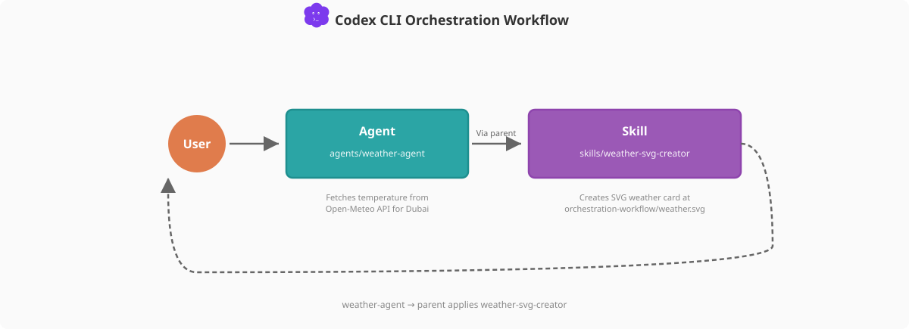

# codex-cli-best-practice
from vibe coding to agentic engineering - practice makes codex perfect

 <a href="https://github.com/shanraisshan/codex-cli-best-practice/stargazers"></a>

[](best-practice/) [](.codex/) [](orchestration-workflow/orchestration-workflow.md) [](https://learn.chatgpt.com/docs/codex/cli) [](#tips-and-tricks) <br>
 = Agents ·  = Commands ·  = Skills

<p align="center">
  
</p>

[How to Use](#how-to-use) · [Verification history](changelog/best-practice/concepts/changelog.md) · [Verification checklist](changelog/best-practice/concepts/verification-checklist.md)

## 🧠 CONCEPTS

| Feature | Location | Description |
|---------|----------|-------------|
|  [**Commands**](https://learn.chatgpt.com/docs/developer-commands?surface=cli#built-in-slash-commands) | Interactive slash menu | Use `/plan`, `/review`, `/model`, and `/permissions`. Save recurring prompts and commands with `/presets` |
| [**Goals**](https://learn.chatgpt.com/docs/long-running-work) | `/goal` | Set a persistent objective with a verifiable completion condition |
|  [**Subagents**](https://learn.chatgpt.com/docs/agent-configuration/subagents) | [`.codex/agents/`](.codex/agents/) · `/subagents` | [](best-practice/codex-subagents.md) [](.codex/agents/) Delegate independent work to built-in or custom agents |
|  [**Skills**](https://learn.chatgpt.com/docs/build-skills) | [`.agents/skills/`](.agents/skills/) | [](best-practice/codex-skills.md) [](.agents/skills/) [Reference](docs/SKILLS.md) Reusable instructions. Find them with `/skills` or mention `$skill-name` |
| [**Plugins**](https://learn.chatgpt.com/docs/plugins) | `/plugins` · `codex plugin` | Install bundles that can include skills, apps, MCP servers, and hooks |
| **Marketplace** | `.agents/plugins/marketplace.json` | [](best-practice/codex-marketplace.md) Manage catalogs with `codex plugin marketplace add\|list\|upgrade\|remove` |
| [**Memories**](https://learn.chatgpt.com/docs/customization/memories) | `/memories` · `[features].memories` | [](best-practice/codex-memory.md) Opt in to carry context across chats using the local memory store |
| **Workflows** | [Weather agent](.codex/agents/weather-agent.toml) | [](orchestration-workflow/orchestration-workflow.md) Fetch data with a custom agent, then render an artifact with a skill |
| [**MCP Servers**](https://learn.chatgpt.com/docs/extend/mcp) | `[mcp_servers.*]` · `codex mcp` | [](best-practice/codex-mcp.md) [](.codex/config.toml) Connect to stdio or Streamable HTTP servers. The experimental [App Server](https://learn.chatgpt.com/docs/app-server) replaces the removed `codex mcp-server` for embedding Codex |
| [**Config**](https://learn.chatgpt.com/docs/config-file/config-basic) | [`.codex/config.toml`](.codex/config.toml) | [](best-practice/codex-config.md) Trusted project and user layers, named config profiles, and CLI overrides |
| [**Permissions**](https://learn.chatgpt.com/docs/agent-approvals-security) | `/permissions` · `/approve` | Control sandboxing and approvals. Named [filesystem and network permission profiles](https://learn.chatgpt.com/docs/permissions) are in beta |
| [**Rules**](https://learn.chatgpt.com/docs/agent-configuration/rules)  | `.codex/rules/` | Use Starlark `prefix_rule()` to control commands outside the sandbox |
| [**AGENTS.md**](https://learn.chatgpt.com/docs/agent-configuration/agents-md) | [`AGENTS.md`](AGENTS.md) | [](best-practice/codex-agents-md.md) Layer one instruction file per directory from the project root to the working directory |
| [**Hooks**](https://learn.chatgpt.com/docs/hooks) | [`.codex/hooks.json`](.codex/hooks.json) · `/hooks` | [](best-practice/codex-hooks.md) [](.codex/hooks/) Run command or MCP hooks at lifecycle events. Review and trust new or changed project hooks |
| [**Models**](https://learn.chatgpt.com/docs/models) | `/model` · `--model` | The v0.171.0 catalog defaults to GPT-6.2 Sol and includes GPT-6.2 Astra and GPT-6.1 Terra. Availability depends on provider, account, and workspace |
| [**Speed**](https://learn.chatgpt.com/docs/agent-configuration/speed#codex-cli-controls) | `/fast` · `/ultrafast` | Select a supported speed tier when offered by your model catalog and plan |
| [**Code Review**](https://learn.chatgpt.com/docs/code-review) | `/review` · `codex review` | Review a branch, uncommitted changes, or a commit. Configure `review_model` for a separate review model |
| [**Sessions**](https://learn.chatgpt.com/docs/developer-commands?surface=cli#built-in-slash-commands) | `codex agents` · `/agents` | Search sessions, resume or fork work, archive or restore sessions, and export transcripts |
| [**Worktrees**](https://learn.chatgpt.com/docs/environments/git-worktrees) | `codex --worktree` · `/worktree` | Work in an isolated Git checkout while other sessions use the repository |
| [**Non-interactive mode**](https://learn.chatgpt.com/docs/non-interactive-mode) | `codex exec` | Run scripted tasks with JSONL events or structured output. See the [CI example](examples/ci-cd/github-actions.yml) |
| **AI Terms** | | [](https://github.com/shanraisshan/claude-code-codex-cursor-gemini/blob/main/reports/ai-terms.md) Agentic Engineering · Context Engineering · Vibe Coding |
| [**Best Practices**](https://learn.chatgpt.com/guides/best-practices) | | [Prompting](https://learn.chatgpt.com/docs/prompting) · [Codex CLI guide](https://learn.chatgpt.com/docs/codex/cli) |

### 🔥 Hot

| Feature | Location | Description |
|---------|----------|-------------|
| [**Terminal workspace**](https://github.com/openai/codex/releases/tag/rust-v0.171.0) | Fullscreen TUI | Enabled by default in v0.171.0, with searchable document previews, image previews, and subagent transcripts alongside the main chat |
| [**Remote control**](https://github.com/openai/codex/releases/tag/rust-v0.171.0) | `/rc` or `/remote` | Manage local remote control and show device pairing codes |
| [**Remote exec**](https://github.com/openai/codex/releases/tag/rust-v0.171.0) | `codex exec --remote <ADDR>` | Start or resume a non-interactive session on an existing experimental app server |
| [**MCP status line**](https://github.com/openai/codex/releases/tag/rust-v0.171.0)  | `/statusline` | Create or select a custom MCP status line with `features.tui_extensions_statusline` enabled |
| [**Terminal controls**](https://learn.chatgpt.com/docs/cli-customization) | `/config` · `/keymap` · `/tui` | Change preferences, remap shortcuts, and choose fullscreen or scrollback |
| [**Background server**](https://github.com/openai/codex/releases/tag/rust-v0.157.0) | `/daemon` · `--no-daemon` | Eligible interactive sessions share a local server. Use `--no-daemon` for an isolated launch |
| [**Desktop handoff**](https://learn.chatgpt.com/docs/developer-commands?surface=cli#continue-in-the-desktop-app-with-app) | `/app` | Continue the CLI chat in the desktop app on macOS or Windows |
| [**Import**](https://learn.chatgpt.com/docs/import) | `/import` | Preview supported setup and chats from Claude Code or Cursor and choose what to migrate |

<p align="center">
  
</p>

[](orchestration-workflow/orchestration-workflow.md)

See [orchestration-workflow](orchestration-workflow/orchestration-workflow.md) for implementation details of  **Agent** →  **Skill** pattern. The agent fetches the temperature from Open-Meteo, and the parent passes it to the SVG creator skill.

<p align="center">
  
</p>


```bash
codex
> Use weather-agent to fetch the current temperature in Dubai in Celsius, then use $weather-svg-creator to create the weather card.
```

> The prompt supplies the temperature unit. Save it with [`/presets`](https://learn.chatgpt.com/docs/developer-commands?surface=cli#reuse-prompts-and-commands-with-presets) to run it again.

<p align="center">
  
</p>

## ⚙️ DEVELOPMENT WORKFLOWS

All major workflows converge on the same architectural pattern: **Research → Plan → Execute → Review → Ship**

| Name | ★ | Workflow |  |  |
|------|---|----------|---|---|
| [Superpowers](https://github.com/obra/superpowers) |  |  →  →  →  →  →  | 5 | 14 |
| [Spec Kit](https://github.com/github/spec-kit) |  |  →  →  →  →  | 0 | 0 |
| [gstack](https://github.com/garrytan/gstack) |  |  →  →  →  →  →  →  →  →  | 0 | 41 |
| [Get Shit Done](https://github.com/gsd-build/get-shit-done) |  |  →  →  →  →  →  →  | 33 | 0 |
| [oh-my-codex](https://github.com/Yeachan-Heo/oh-my-codex) |  |  →  →  | 19 | 36 |
| [Compound Engineering](https://github.com/EveryInc/compound-engineering-plugin) |  |  →  →  →  →  →  →  | 49 | 42 |

> *Yellow tags show steps that repeat inside a parent step. Workflow steps and counts are snapshots; check the linked project for its current inventory.*

### Others
- [Cross-Model (Claude Code + Codex) Workflow](https://github.com/shanraisshan/claude-code-best-practice/blob/main/development-workflows/cross-model-workflow/cross-model-workflow.md) [](https://github.com/shanraisshan/claude-code-best-practice/blob/main/development-workflows/cross-model-workflow/cross-model-workflow.md)

<p align="center">
  
</p>

<a id="tips-and-tricks"></a>

## 💡 TIPS AND TRICKS (50)

[Prompting](#tips-prompting) · [Planning](#tips-planning) · [AGENTS.md](#tips-agentsmd) · [Agents](#tips-agents) · [Skills](#tips-skills) · [Hooks](#tips-hooks) · [Memories](#tips-memory) · [Workflows](#tips-workflows) · [Advanced](#tips-workflows-advanced) · [Git / PR](#tips-git-pr) · [Debugging](#tips-debugging) · [Utilities](#tips-utilities) · [Daily](#tips-daily)


<a id="tips-prompting"></a>■ **Prompting (3)**

| Tip |
|-----|
| challenge Codex — "prove to me this works" and have Codex diff between main and your branch |
| after a mediocre fix — "knowing everything you know now, scrap this and implement the elegant solution" |
| Codex fixes most bugs by itself — paste the bug, say "fix", don't micromanage how |

<a id="tips-planning"></a>■ **Planning (4)**

| Tip |
|-----|
| use [/plan](https://learn.chatgpt.com/docs/developer-commands?surface=cli) when you want an explicit plan — Codex may also plan automatically for multi-step tasks |
| always make a phase-wise gated plan, with each phase having multiple tests (unit, automation, integration) |
| spin up a second Codex (or use [cross-model](https://github.com/shanraisshan/claude-code-best-practice/blob/main/development-workflows/cross-model-workflow/cross-model-workflow.md)) to review your plan as a staff engineer |
| write detailed specs and reduce ambiguity before handing work off — the more specific you are, the better the output |

<a id="tips-agentsmd"></a>■ **AGENTS.md (5)**

| Tip |
|-----|
| keep [AGENTS.md](https://learn.chatgpt.com/docs/agent-configuration/agents-md) concise — 150 lines is a useful heuristic, but the actual project budget is byte-based (32 KiB by default) |
| use [AGENTS.override.md](https://learn.chatgpt.com/docs/agent-configuration/agents-md) for personal preferences without affecting the team |
| any developer should be able to launch Codex, say "run the tests" and it works on the first try — if it doesn't, your AGENTS.md is missing essential setup/build/test commands |
| keep codebases clean and finish migrations — partially migrated frameworks confuse models that might pick the wrong pattern |
| use [config.toml](https://learn.chatgpt.com/docs/config-file/config-basic) for harness-enforced behavior (approval policy, sandbox, model) — don't put behavioral rules in AGENTS.md when config.toml settings are deterministic |

<a id="tips-agents"></a> **Agents (3)**

| Tip |
|-----|
| have feature specific [sub-agents](https://learn.chatgpt.com/docs/agent-configuration/subagents) with [skills](https://learn.chatgpt.com/docs/build-skills) instead of general qa, backend engineer |
| use [multi-agent](https://learn.chatgpt.com/docs/agent-configuration/subagents) to throw more compute at a problem — offload tasks to keep your main context clean and focused |
| use test time compute — separate context windows make results better; one agent can cause bugs and another can find them |

<a id="tips-skills"></a> **Skills (7)**

| Tip |
|-----|
| use [skills](https://learn.chatgpt.com/docs/build-skills) with clear name and description frontmatter for auto-discovery |
| skills are folders, not files — use references/, scripts/, examples/ subdirectories for [progressive disclosure](https://learn.chatgpt.com/docs/build-skills) |
| build a Gotchas section in every skill — highest-signal content, add Codex's failure points over time |
| skill description field is a trigger, not a summary — write it for the model ("when should I fire?") |
| don't state the obvious in skills — focus on what pushes Codex out of its default behavior |
| don't railroad Codex in skills — give goals and constraints, not prescriptive step-by-step instructions |
| use the built-in skill creator to scaffold new skills, and document one invocation style consistently across the repo |

<a id="tips-hooks"></a>■ **Hooks (3)**

| Tip |
|-----|
| use [hooks](https://learn.chatgpt.com/docs/hooks) for logging, security scanning, and validation and review new or changed project hooks with `/hooks` |
| use hooks for auto-formatting code — Codex generates well-formatted code, the hook handles the last 10% to avoid CI failures |
| branch `SessionStart` on `source` (`startup \| resume \| clear`) — skip heavy context on `clear` so `/clear` stays snappy (v0.120.0+) |

<a id="tips-memory"></a>■ **Memories (2)**

| Tip |
|-----|
| opt in to [memories](https://learn.chatgpt.com/docs/customization/memories) to retain useful context across sessions, and use `/memories` for chat-level controls |
| set `no_memories_if_mcp_or_web_search = true` for threads that touch secrets or untrusted content — reset via `/memories → Reset` if exposure happens |

<a id="tips-workflows"></a>■ **Workflows (4)**

| Tip |
|-----|
| vanilla Codex is better than any workflows with smaller tasks |
| use [profiles](https://learn.chatgpt.com/docs/config-file/config-basic) to load named user config files; see the [profile examples](examples/profiles/) |
| start with [on-request](https://learn.chatgpt.com/docs/agent-approvals-security) for interactive work and use `never` with a deliberate sandbox policy for unattended runs |
| use [/fork](https://learn.chatgpt.com/docs/developer-commands?surface=cli) in-session (or `codex fork`) to explore alternatives without losing your current thread, and [/resume](https://learn.chatgpt.com/docs/developer-commands?surface=cli) (or `codex resume`) to pick up where you left off |

<a id="tips-workflows-advanced"></a>■ **Workflows Advanced (5)**

| Tip |
|-----|
| use [multi-agent](https://learn.chatgpt.com/docs/agent-configuration/subagents) to delegate independent work and inspect it with `/subagents` |
| use [codex exec](https://learn.chatgpt.com/docs/non-interactive-mode) for headless/CI pipelines |
| combine [sandbox modes](https://learn.chatgpt.com/docs/agent-approvals-security) with [approval policies](https://learn.chatgpt.com/docs/agent-approvals-security) — workspace-write + on-request is a good default |
| [git worktrees](https://git-scm.com/docs/git-worktree) for parallel development |
| use ASCII diagrams a lot to understand your architecture |

<a id="tips-git-pr"></a>■ **Git / PR (3)**

| Tip | Source |
|-----|--------|
| keep PRs small and focused — one feature per PR, easier to review and revert | |
| always squash merge PRs — clean linear history, one commit per feature, easy git revert and git bisect | |
| commit often — as soon as a task is completed, commit |  |

<a id="tips-debugging"></a>■ **Debugging (5)**

| Tip | Source |
|-----|--------|
| always ask Codex to run the terminal (you want to see logs of) as a background task for better debugging | |
| use MCP ([Chrome DevTools](https://developer.chrome.com/blog/chrome-devtools-mcp), [Playwright](https://github.com/microsoft/playwright-mcp)) to let Codex see browser console logs on its own | |
| make it a habit to take screenshots and share with Codex whenever you are stuck with any issue |  |
| use a different model for QA — e.g. [Claude Code](https://github.com/shanraisshan/claude-code-best-practice) for plan and implementation review | |
| agentic search (glob + grep) beats RAG — code drifts out of sync and permissions are complex | |

<a id="tips-utilities"></a>■ **Utilities (4)**

| Tip | Source |
|-----|--------|
| [iTerm](https://iterm2.com/)/[Ghostty](https://ghostty.org/)/[tmux](https://github.com/tmux/tmux) terminals instead of IDE ([VS Code](https://code.visualstudio.com/)/[Cursor](https://www.cursor.com/)) | |
| [Wispr Flow](https://wisprflow.ai) for voice prompting (10x productivity) | |
| [codex-cli-hooks](https://github.com/shanraisshan/codex-cli-hooks) for Codex feedback |  |
| explore config.toml features like [profiles](https://learn.chatgpt.com/docs/config-file/config-basic), [sandbox modes](https://learn.chatgpt.com/docs/agent-approvals-security), and [MCP](https://learn.chatgpt.com/docs/extend/mcp) for a personalized experience | |

<a id="tips-daily"></a>■ **Daily (2)**

| Tip | Source |
|-----|--------|
| update Codex CLI daily |  |
| start your day by reading the [changelog](https://github.com/openai/codex/releases) |  |


| Article / Tweet | Source |
|-----------------|--------|
| How Codex is built — 90% self-built in Rust (Tibo, Pragmatic Engineer) \| 17 Feb 2026 | [](https://x.com/thsottiaux) |
| Skills in Codex — standardizing .agents/skills across agents (Embiricos) \| Feb 2026 | [](https://x.com/embirico) |
| Unrolling the Codex agent loop — how Codex works internally (Bolin) \| Jan 2026 | [Tweet](https://x.com/OpenAIDevs/status/2014794871962533970) |
| AMA with Codex team — CLI, sandbox, agents (Embiricos, Fouad, Tibo + team) \| May 2025 | [Reddit](https://www.reddit.com/r/ChatGPT/comments/1ko3tp1/ama_with_openai_codex_team/) |
| Codex CLI — open-source local coding agent, first look (Fouad + Romain) \| Apr 2025 | [Tweet](https://x.com/OpenAIDevs/status/1912556874211422572) |

<p align="center">
  
</p>

## 🎬 VIDEOS / PODCASTS

| Video / Podcast | Source | Link |
|-----------------|--------|------|
| The power user's guide to Codex — parallelizing workflows, planning, context engineering (Embiricos) \| 2026 \| How I AI | [](https://x.com/embirico) | [Podcast](https://open.spotify.com/episode/6RNqTaOb5ly3zgQCGB23fE) |
| Scaffolding is coping not scaling, and other lessons from Codex (Tibo) \| 2026 \| Dev Interrupted | [](https://x.com/thsottiaux) | [Podcast](https://linearb.io/dev-interrupted/podcast/openai-codex-thibault-sottiaux-agentic-autonomy) |
| How Codex team uses their coding agent (Tibo + Andrew) \| 18 Feb 2026 \| Every | [](https://x.com/thsottiaux) | [Podcast](https://every.to/podcast/transcript-how-openai-s-codex-team-uses-their-coding-agent) |
| Dogfood — Codex team uses Codex to build Codex (Tibo) \| 24 Feb 2026 \| Stack Overflow | [](https://x.com/thsottiaux) | [Podcast](https://stackoverflow.blog/2026/02/24/dogfood-so-nutritious-it-s-building-the-future-of-sdlcs/) |
| Why humans are AI's biggest bottleneck — Codex product vision (Embiricos) \| Feb 2026 \| Lenny's Podcast | [](https://x.com/embirico) | [Podcast](https://www.lennysnewsletter.com/p/why-humans-are-ais-biggest-bottleneck) |
| OpenAI and Codex (Tibo + Ed Bayes) \| 29 Jan 2026 \| Software Engineering Daily | [](https://x.com/thsottiaux) | [Podcast](https://softwareengineeringdaily.com/2026/01/29/openai-and-codex-with-thibault-sottiaux-and-ed-bayes/) |

<p align="center">
  
</p>

## 🔔 SUBSCRIBE

| Source | Name | Badge |
|--------|------|-------|
|  | [r/ChatGPT](https://www.reddit.com/r/ChatGPT/), [r/OpenAI](https://www.reddit.com/r/OpenAI/), [r/Codex](https://www.reddit.com/r/Codex/) |  |
|  | [OpenAI](https://x.com/OpenAI), [OpenAI Devs](https://x.com/OpenAIDevs), [Tibo](https://x.com/thsottiaux), [Embiricos](https://x.com/embirico), [Jason](https://x.com/jxnlco), [Romain](https://x.com/romainhuet), [Dominik](https://x.com/dkundel), [Fouad](https://x.com/fouadmatin), [Bolin](https://x.com/bolinfest) |  |
|  | [Jesse Kriss](https://x.com/obra) ([Superpowers](https://github.com/obra/superpowers)), [Garry Tan](https://x.com/garrytan) ([gstack](https://github.com/garrytan/gstack)), [Kieran Klaassen](https://x.com/kieranklaassen) ([Compound Eng](https://github.com/EveryInc/compound-engineering-plugin)), [Lex Christopherson](https://x.com/official_taches) ([GSD](https://github.com/gsd-build/get-shit-done)), [Yeachan Heo](https://x.com/bellman_ych) ([oh-my-codex](https://github.com/Yeachan-Heo/oh-my-codex)), [Andrej Karpathy](https://x.com/karpathy) |  |
|  | [OpenAI](https://www.youtube.com/@OpenAI) |  |
|  | [Lenny's Podcast](https://www.youtube.com/@LennysPodcast), [The Pragmatic Engineer](https://www.youtube.com/@pragmaticengineer) |  |

<p align="center">
  
</p>

<a href="https://github.com/shanraisshan/claude-code-best-practice#billion-dollar-questions"></a>

<p align="center">
  
</p>

## How to Use

1. Install or update the [Codex CLI](https://learn.chatgpt.com/docs/codex/cli) and run `codex --version`.
2. Start with **Concepts** to find the right feature and its examples.
3. Run the [weather workflow](orchestration-workflow/orchestration-workflow.md) from the repo root, or try the [profile examples](examples/profiles/) in an isolated setup.
4. Check the [verification history](changelog/best-practice/concepts/changelog.md) for the audited CLI version, sources, and test results.

For a multi-step task with a clear finish line, try `/goal Verify every changed Markdown link and fix failures, then record the checks in the changelog.`

## Other Repos

<a href="https://github.com/shanraisshan/codex-cli-hooks"></a> <a href="https://github.com/shanraisshan/codex-cli-hooks"><strong>codex-cli-hooks</strong></a> · <a href="https://github.com/shanraisshan/claude-code-best-practice"></a> <a href="https://github.com/shanraisshan/claude-code-best-practice"><strong>claude-code-best-practice</strong></a> · <a href="https://github.com/shanraisshan/claude-code-hooks"></a> <a href="https://github.com/shanraisshan/claude-code-hooks"><strong>claude-code-hooks</strong></a>

---

<a href="https://openai.com/form/codex-for-oss/"></a>

<p align="center">
  
</p>

##  Sponsor My Work

If you like my work, buy me a doodh patti 🍵 on

<a href="https://buy.polar.sh/polar_cl_jOwGyidIfOUWcvUAyiQc5nvTjN51EePzqzyW40tvXIX"></a> <a href="https://buy.polar.sh/polar_cl_jOwGyidIfOUWcvUAyiQc5nvTjN51EePzqzyW40tvXIX"><strong>Polar</strong></a>
