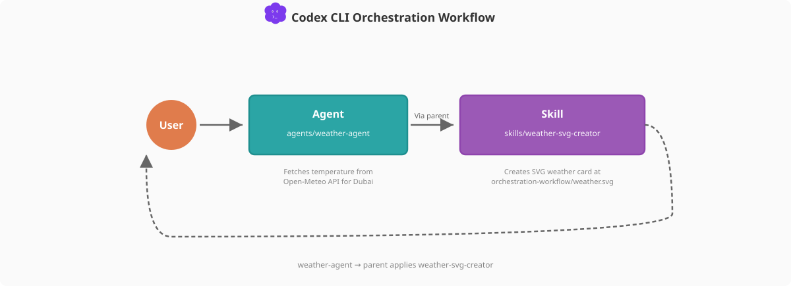

# Orchestration Workflow

This document describes the **Agent → Skill** orchestration workflow, demonstrated through a weather data fetching and SVG rendering system.

<table width="100%">
<tr>
<td><a href="../">← Back to Codex CLI Best Practice</a></td>
<td align="right"></td>
</tr>
</table>

## System Overview

The weather system demonstrates two component patterns within a single orchestration workflow:
- **Agent**: `weather-agent` fetches temperature from Open-Meteo using inlined `developer_instructions`
- **Skill** (independent): `weather-svg-creator` is used by the parent to create the visual output

This showcases the **Agent → Skill** architecture pattern, where:
- A custom agent fetches data and returns the value and unit
- The parent uses the skill with the returned data

## 

Start Codex from the repository root and enter this prompt:

```bash
codex
> Use weather-agent to fetch the current temperature in Dubai in Celsius, then use $weather-svg-creator to create the weather card.
```

Specify "in Fahrenheit" in your prompt to switch units. The agent defaults to Celsius if no preference is given.

Output files:
- `orchestration-workflow/weather.svg` — SVG weather card
- `orchestration-workflow/output.md` — Markdown summary

> Reuse the prompt with [`/presets`](https://learn.chatgpt.com/docs/developer-commands?surface=cli#reuse-prompts-and-commands-with-presets). The caller supplies the unit and the agent defaults to Celsius. Open-Meteo requires network access from the execution environment. If the shell network is blocked, use an allowed tool or approve the specific fetch when prompted.

## Component Summary

| Component | Role | Example |
|-----------|------|---------|
| **Agent** | Fetches the weather and returns structured facts | [`weather-agent`](../.codex/agents/weather-agent.toml) |
| **Skill** | Creates output independently | [`weather-svg-creator`](../.agents/skills/weather-svg-creator/SKILL.md) |

## Flow Diagram

<p align="center">
  
</p>

```
╔══════════════════════════════════════════════════════════════════╗
║              ORCHESTRATION WORKFLOW                              ║
║                    Agent  →  Skill                               ║
╚══════════════════════════════════════════════════════════════════╝

                         ┌───────────────────┐
                         │  User Prompt      │
                         │  (specifies C°/F°)│
                         └─────────┬─────────┘
                                   │
                         Step 1 — Agent
                                   │
                                   ▼
         ┌─────────────────────────────────────────────────────┐
         │  weather-agent — Agent ● developer_instructions     │
         └─────────────────────────┬───────────────────────────┘
                                   │
                   Returns data to the parent thread
                                   │
                         Step 2 — Skill
                                   │
                                   ▼
         ┌─────────────────────────────────────────────────────┐
         │  weather-svg-creator — Skill ● SVG card + output    │
         └─────────────────────────┬───────────────────────────┘
                                   │
                          ┌────────┴────────┐
                          │                 │
                          ▼                 ▼
                   ┌────────────┐    ┌────────────┐
                   │weather.svg │    │ output.md  │
                   └────────────┘    └────────────┘
```

## Component Details

### 1. Agent

#### `weather-agent` (Agent)
- **Location**: `.codex/agents/weather-agent.toml`
- **Purpose**: Fetches the temperature for Dubai and returns it to the parent
- **Model**: Inherited from the parent
- **Discovery**: Standalone TOML file under `.codex/agents/`

The agent fetches the current temperature from Open-Meteo in the requested unit and returns the result. The parent passes that data to the skill.

### 2. Skill

#### `weather-svg-creator` (Skill)
- **Location**: `.agents/skills/weather-svg-creator/SKILL.md`
- **Purpose**: Create a visual SVG weather card and write output files
- **Invocation**: A `$weather-svg-creator` mention in the parent prompt
- **Outputs**:
  - `orchestration-workflow/weather.svg` — SVG weather card
  - `orchestration-workflow/output.md` — Weather summary

## Execution Flow

1. **User Prompt**: Name the agent and skill and give a unit preference
2. **Agent Start**: Codex delegates the fetch to `weather-agent` on request
3. **Data Fetching**: Agent fetches temperature from Open-Meteo API for Dubai using curl
4. **Skill Invocation**: The parent uses `$weather-svg-creator` with the agent's result
   - Skill creates SVG weather card at `orchestration-workflow/weather.svg`
   - Skill writes summary to `orchestration-workflow/output.md`
5. **Result Display**: Summary shown to user with temperature, SVG location, and output file

## Example Execution

```
Input: Use weather-agent, then $weather-svg-creator, for Dubai in Celsius
├─ Step 1: Agent fetches from Open-Meteo API
│  └─ Returns: temperature=29, unit=Celsius, city=Dubai
├─ Step 2: Parent applies $weather-svg-creator
│  ├─ Creates: orchestration-workflow/weather.svg
│  └─ Writes: orchestration-workflow/output.md
└─ Output:
   ├─ Unit: Celsius
   ├─ Temperature: 29°C
   ├─ SVG: orchestration-workflow/weather.svg
   └─ Summary: orchestration-workflow/output.md
```

## Key Design Principles

1. **Prompt as Entry Point**: The parent delegates data fetching to the weather agent
2. **Skill for Rendering**: The SVG creator runs independently, receiving data from the agent's context
3. **Inlined Instructions**: The agent's `developer_instructions` contain the fetching logic
4. **Clean Separation**: Fetch (agent) → Render (skill) — each component has a single responsibility
5. **Idempotent Output**: Running the workflow again overwrites the previous output cleanly

## Architecture Patterns

### Agent (Developer Instructions)

```toml
# In agent definition (.codex/agents/weather-agent.toml)
name = "weather-agent"
description = "Fetches Dubai temperature from Open-Meteo."
developer_instructions = """
Step 1: Fetch from Open-Meteo API (use caller's unit preference, default Celsius)
Step 2: Return city, temperature, unit, and fetch time to the parent
"""
```

- **Handoff**: The parent receives the data and applies the selected skill.

### Skill (Direct Invocation)

```yaml
# In skill definition (.agents/skills/weather-svg-creator/SKILL.md)
---
name: weather-svg-creator
description: Creates an SVG weather card...
---
```

- **Explicit skill mention**: The parent prompt selects `$weather-svg-creator`
- **Independent execution**: Runs in the conversation context with the temperature data available
- **Receives data from context**: Uses temperature data already available in the conversation

## Comparison with Claude Code

| Aspect | Claude Code | Codex CLI |
|---|---|---|
| **Entry point** | Custom Command (`.claude/commands/`) | User prompt or saved preset |
| **User interaction** | Command asks via `AskUserQuestion` tool | User specifies the unit in this example |
| **Data fetching** | Agent with preloaded skill | Agent with inlined `developer_instructions` |
| **Skill invocation** | `Skill()` tool call (deterministic) | `$skill-name` mention in the parent prompt |
| **Agent knowledge** | Preloaded skills via `skills:` field | Inlined via `developer_instructions` |
| **Pattern name** | Command → Agent → Skill | Agent → Skill |
| **Orchestration style** | Imperative (explicit tool calls) | Parent delegates to the agent and applies the skill |
